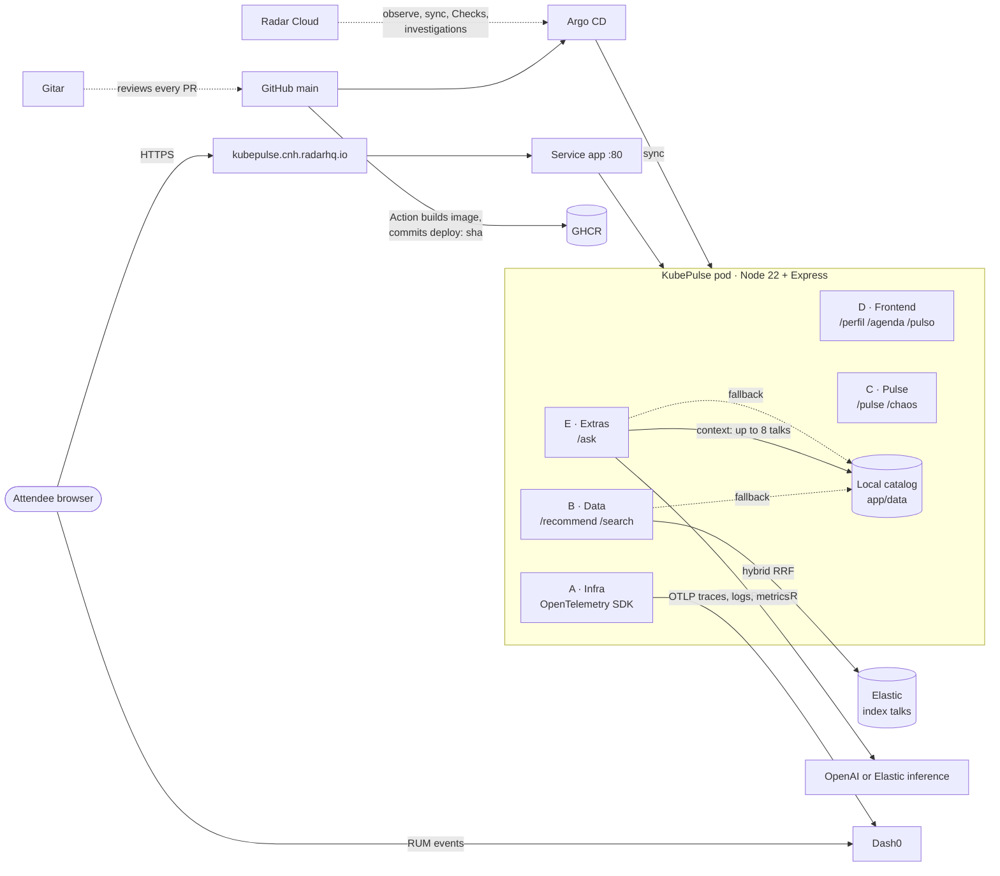

# KubePulse

> **Resumen en español.** KubePulse es un copiloto para asistentes de KubeCon + CloudNativeCon North America 2026
> (Salt Lake City). Armas tu perfil (rol, intereses, idioma, accesibilidad), recibes una agenda personalizada con una
> alternativa en paralelo para cada charla, y ves en vivo qué tan llena está cada sala para no quedarte afuera.
> También puedes hacer preguntas en lenguaje natural sobre la agenda (`POST /ask`). La búsqueda es híbrida en Elastic
> (con respaldo local), la observabilidad va por OpenTelemetry a Dash0, el despliegue es GitOps con Argo CD y se opera
> con Radar, y cada PR lo revisa Gitar. Los datos de ocupación son **simulados**. Demo:
> <https://kubepulse.cnh.radarhq.io>.

KubePulse is a conference copilot built at the Cloud Native Hackathon (KubeCon + CloudNativeCon North America 2026).
It turns the schedule into a personal plan and tells you, live, which rooms are filling up.

**Live demo:** <https://kubepulse.cnh.radarhq.io>

| Page | What it does |
|---|---|
| [`/perfil`](https://kubepulse.cnh.radarhq.io/perfil) | Your profile: name, role, interests, level, language, accessibility needs (captions, wheelchair access, avoid crowded rooms). |
| [`/agenda`](https://kubepulse.cnh.radarhq.io/agenda) | Recommended talks per time slot, why each one matches, a parallel alternative, and a crowd forecast. |
| [`/pulso`](https://kubepulse.cnh.radarhq.io/pulso) | Live room occupancy (Hay espacio / Llenándose / Llena) with the last 30 minutes of history. |

Room occupancy is **simulated**: there are no sensors in the rooms. See [AI usage declaration](#ai-usage-declaration).

## Architecture

One Node 22 + Express 4 app with server-rendered Nunjucks pages and no frontend build. Each module lives in its own
folder and exports an `express.Router()`, which `app/server.js` mounts. The API contract between modules is
[`docs/contracts.md`](docs/contracts.md).

| Module | Folder | Responsibility |
|---|---|---|
| A · Infra | `app/server.js`, `app/telemetry.js`, `Dockerfile`, `deploy/` | Server, OpenTelemetry SDK, container image, Kubernetes manifests. |
| B · Data | `app/src/search/`, `app/data/`, `app/scripts/ingest.js` | Talk catalog, `POST /recommend` and `GET /search`. |
| C · Pulse | `app/src/pulse/` | Occupancy simulator, `GET /pulse`, `GET /pulse/history`, `POST /chaos` (demo only), `room.occupancy` metric. |
| D · Frontend | `app/views/`, `app/public/`, `app/src/pages/` | `/perfil`, `/agenda`, `/pulso`, themes, i18n (es/en), RUM events. |
| E · Extras | `app/src/ask/`, `README.md` | `POST /ask`: questions about the schedule answered by an LLM, with a local fallback. |

What each external service does:

- **Elastic**: index `talks` with hybrid search, combining BM25 and a `semantic_text` field with Reciprocal Rank
  Fusion (RRF). If Elastic is unset, slow or down, the app ranks the local catalog instead and marks the response
  with `X-KubePulse-Source: local` and `X-KubePulse-Degraded: true`. Elastic can also be the LLM behind `/ask`.
- **Dash0**: receives OpenTelemetry traces, logs and metrics (including the `room.occupancy` gauge) over OTLP, and
  real user monitoring (RUM) events from the browser (`profile_saved`, `agenda_confirmed`, `chaos_triggered`, ...).
- **Radar**: the team's Kubernetes cluster is operated through Radar Cloud: GitOps syncs with Argo CD, rollouts,
  issues, AI investigations, and Checks (the namespace's Checks findings went from 4 to 0).
- **Gitar**: reviews every pull request, with three repository rules in `.gitar/rules/`: `contract-owners` (folder
  owners and the API contract), `no-secrets` (no credentials in a public repo) and `timezone-iso` (every time is
  ISO 8601 with the `-07:00` offset).



### `POST /ask`

Request `{ "question": "...", "profile": { ... }, "lang": "es|en" }`. `question` is required and at most 500
characters; `profile` (same shape as `/recommend`) and `lang` are optional (default `es`).
Response `{ "answer": "...", "citations": ["t-0920-ace"], "provider": "openai|elastic|none", "degraded": false }`.

The app ranks the talk catalog against the question and the profile's interests and gives the LLM at most 8 talks as
context. If `LLM_PROVIDER` is `none`, or the provider fails or takes longer than 4 seconds, the answer is a template
listing the best local matches, with `provider: "none"`, `degraded: true` and the headers
`X-KubePulse-Source: local` and `X-KubePulse-Degraded: true`. The question itself is never logged.

## Run locally

Requires Node 22 or later.

```bash
cd app
npm ci
npm start                       # http://localhost:8080
PORT=3000 DEMO_MODE=true npm start
```

With no environment variables set, everything works offline: search and `/ask` use the local catalog, and telemetry
is off. To try the external services, put the variables below in a file outside the repo and run
`node --env-file=<file> server.js`.

Tests use Node's built-in runner and never call the network:

```bash
cd app
node --test
```

## Environment variables

In the cluster these come from the Kubernetes Secret `kubepulse-secrets`, created outside git. Never commit values.

| Variable | Description |
|---|---|
| `PORT` | HTTP port (default `8080`). |
| `DEMO_MODE` | `true` enables `POST /chaos`, which fills one room to 96% or more for 3 minutes. Otherwise `/chaos` is 404. |
| `APP_VERSION` | Version shown by `/version`; the image build sets it to the commit SHA. |
| `ELASTIC_ENDPOINT` | Elasticsearch URL for the `talks` index (and the `/ask` LLM when `LLM_PROVIDER=elastic`). |
| `ELASTIC_API_KEY` | Elasticsearch API key. |
| `ELASTIC_LLM_INFERENCE_ID` | Inference endpoint id (`completion` task) used by `/ask` when `LLM_PROVIDER=elastic`. Proposed for the contract. |
| `LLM_PROVIDER` | `openai`, `elastic` or `none` (default `none`): which LLM answers `/ask`. |
| `OPENAI_API_KEY` | OpenAI API key, used when `LLM_PROVIDER=openai`. |
| `OPENAI_MODEL` | Optional OpenAI model for `/ask` (default `gpt-4o-mini`). Proposed for the contract. |
| `OTEL_EXPORTER_OTLP_ENDPOINT` | OTLP endpoint (Dash0). Telemetry is off when unset. |
| `OTEL_EXPORTER_OTLP_HEADERS` | OTLP headers, including the Dash0 auth token. |
| `OTEL_EXPORTER_OTLP_PROTOCOL` | OTLP protocol, e.g. `http/protobuf` or `grpc`. |
| `DASH0_RUM_TOKEN` | Ingest-only token for browser RUM events. |
| `DASH0_RUM_ENDPOINT` | Dash0 endpoint for browser RUM events. |

## Deploy

Deploys are GitOps; nobody applies app manifests by hand.

1. A pull request is reviewed (by a person and by Gitar) and merged to `main`.
2. The `build-and-deploy` GitHub Action builds the image, pushes it to GHCR tagged with the first 7 characters of the
   commit, and commits `deploy: <sha> [skip ci]`, which points `deploy/kustomization.yaml` at that image.
   Changes to Markdown files alone don't trigger a build.
3. Argo CD, running in the cluster, syncs `deploy/` to namespace `team-kubepulse`. The team checks the rollout and
   the live version (`/version`) through Radar.

## kubectl

Radar is the main way in, but kubectl and helm work too. The cluster's kubeconfig is in Secret `kubeconfig` in
namespace `default`, key `config`:

1. In Radar Cloud, open the cluster, then **Resources** > **Secrets** (under Configuration), and open `kubeconfig`
   in namespace `default`.
2. Under **Data**, click **Reveal** next to `config`, then the copy icon beside it ("Copy value"). Don't do this
   while sharing your screen.
3. Save it to a file outside the repo (the repo is public, and anyone with this file is cluster-admin), and use it:
   ```bash
   export KUBECONFIG=~/cnh-kubeconfig
   kubectl get pods -n team-kubepulse
   ```

It talks to `https://kubepulse.vc.cnh.radarhq.io`. Its token lasts 24 hours and the platform replaces it about every
12 hours, so a fresh copy is good for at least 12 hours. If kubectl says `Unauthorized`, copy it again.

## When something's wrong

- **A pod stays `Pending`.** Read its events in Radar. A `SyncError` means the host refused it:
  `exceeded quota: team-quota` means the team is over its budget; otherwise it asks for privileged or host access.
- **The URL answers 404 or 503 while the pods are healthy.** Check Service `app` in `team-kubepulse`: port 80, and a
  selector that matches the ready pods.
- **kubectl says `Unauthorized`.** The token expired. Copy `config` again.
- **Radar Cloud is down.** Run Radar locally with the kubeconfig (copy it early, so you have one):
  ```bash
  curl -fsSL https://get.radarhq.io | sh
  kubectl radar --kubeconfig ~/cnh-kubeconfig
  ```
  Its MCP server is `http://localhost:9280/mcp`. It sees only this cluster, so its tools take no `cluster`.

## AI usage declaration

KubePulse was built with several AI coding agents working in parallel, each on its own branch and limited to its own
folders (the modules above), plus a coordinating agent that merged the work and owned the contract. The person on the
team defined the contracts in `docs/contracts.md`, reviewed every pull request (in addition to Gitar's automated
review) and understands every part of the code. The `/ask` endpoint can call an LLM (OpenAI or Elastic) at runtime;
its answers are limited to talks from the catalog.

Room occupancy data is simulated. It does not come from real attendance.

## Attribution

The Phippy & Friends characters are © Cloud Native Computing Foundation, licensed under
[CC BY 4.0](https://creativecommons.org/licenses/by/4.0/). See <https://phippy.io>. KubePulse uses Phippy, Obee and
Keddy in `app/public/mascots/` (`phippy_full.svg`, `obee_full.svg`, `keddy_full.svg`).

This repository started from the Radar AI SRE track starter for the Cloud Native Hackathon
([skyhook-io/cnh-starter](https://github.com/skyhook-io/cnh-starter)).
